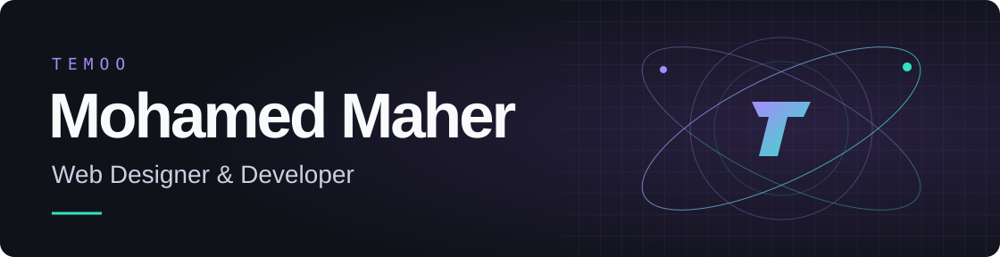

I design and build websites, web apps, and interactive 3D experiences, from the first sketch to launch. My work spans interface design, front-end development, and deployment, with particular care for Arabic and right-to-left interfaces.

أنا محمد ماهر، مصمّم ومطوّر ويب. أصمّم وأبني مواقع وتطبيقات وتجارب ثلاثية الأبعاد، من الفكرة لحد الإطلاق.

**[Explore my portfolio ↗](https://temoo.dev/en)**

## Featured project · Human Atlas

An interactive anatomy explorer built with **React and Three.js**. Select individual structures, toggle anatomical systems, or pull a model apart to see how the pieces fit together.

- **3,400+ selectable structures** across two reference bodies
- **English and Arabic** with right-to-left layouts and bilingual search
- **Browser-based 3D** with GPU-driven visibility and selection

**[Launch the atlas ↗](https://atlas.taim.best/)** · [Source code](https://github.com/slorksmo/Human-Atlas) · [Anatomy data credits](https://github.com/slorksmo/Human-Atlas/blob/main/public/ATTRIBUTION.md)

 

## More selected work

| Project | What it does |
| :-- | :-- |
| **[TemoQR ↗](https://temoqr.com/)** | Web tools for creating QR codes. |
| **[Timo Note ↗](https://note.temoo.dev/)** | A browser-based workspace for writing notes. |
| **[Easy POS Arabia](https://github.com/slorksmo/easy-pos-arabia)** | A self-hosted, offline-first point-of-sale app for Arabic-speaking small businesses. |
| **[mrmo-yt](https://github.com/slorksmo/mrmo-yt)** | A version-controlled homelab deployment stack using Docker Compose and Portainer. |
